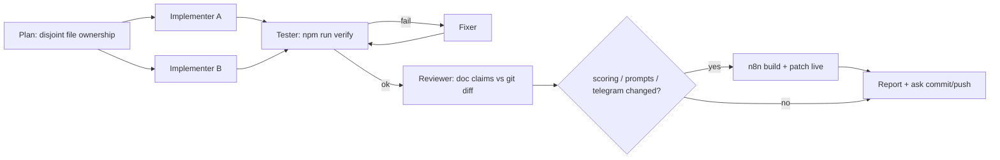

# Slice Execution Workflow (pre-prompt)

Шаблон для выполнения слайсов из [audit-and-backlog.md](audit-and-backlog.md). Основан на
ретроспективе S1-T1 (параллельные субагенты, implementer + tester) и исправляет найденные
там проблемы: агенты правили одни и те же файлы, а в доке появились «выполненные» пункты,
которых нет в `git diff`.

## Pre-prompt

```text
Task: <one observable outcome>
Mode: <quick | feature | high-assurance>
Role: implementer
Scope: <files, components>
Out of scope: <explicit exclusions>
Constraints: AGENTS.md rules; no `any`; mocked HTTP/Playwright in tests;
             never hand-edit n8n/prompts/candidate_profile.md or .notion-snapshot.json
Context to inspect: <only files needed>
Acceptance checks: `cd scraper && npm run verify` green + slice-specific checks
Stop conditions: <unknowns, live n8n / Notion changes, failing checks after 2 fix rounds>
Steps:
  1. Plan: split work into sub-tasks with DISJOINT file ownership.
  2. Implement: one subagent per sub-task; dependent sub-tasks run sequentially.
  3. Verify: one tester subagent runs `npm run verify`; on failure → fixer subagent → re-verify.
  4. Review: read-only reviewer compares every "✅ done" claim in docs with `git diff`.
  5. If scoring / prompts / Telegram templates changed:
     `cd n8n && npm run build` → `python3 scripts/patch-n8n-hitl-review.py`.
  6. Report git status to the user; commit & push to origin/main ONLY after approval.
Model errors (429/503/unavailable): retry once, then fall back to `flash`.
```

## Workflow



## Rules learned from S1-T1

| Problem in S1-T1 | Rule |
| :--- | :--- |
| Two agents edited the same 6 scrapers → duplicate export error | Each subagent owns a disjoint set of files; shared files go to one owner. |
| Doc claimed `closeBrowser()` removed and n8n patched, but neither was in the commit | A reviewer checks claims against `git diff` before marking `[x]` / «✅». |
| Auto commit + push | Commit and push only after the user approves (AGENTS.md). |
| Dedup moved earlier without checking downstream effects (salary enrichment lost) | Plan includes a "downstream effects" check for every reordered pipeline step. |
